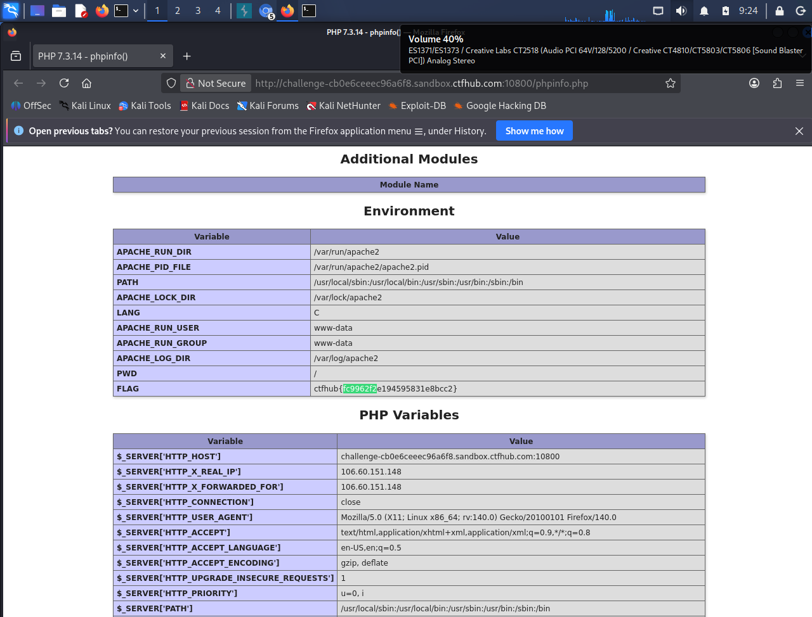

# WP：PHPINFO

> **CTFHub 路径**：技能树 → Web → 信息泄露 → PHPINFO
> **任务**：在 phpinfo 页面中找到 flag，并观察它泄露了哪些信息。
> **提示**：phpinfo 会输出大量 PHP 和服务器配置。用浏览器的查找功能搜索关键字，同时留意页面暴露的路径、版本、环境变量等信息。
> **截图要求**：能看到 phpinfo 页面、你搜索/定位到的 flag，以及至少一处敏感信息。

---

## 题目信息

| 项目 | 内容 |
| --- | --- |
| 环境地址 | http://challenge-cb0e6ceee96a6f8.sandbox.ctfhub.com:10800/phpinfo.php |
| Flag | ctfhub{fc9962f2e194595831e8bcc2} |

## 解题过程

靶场首页只有一句提示，说明目录下留有 `phpinfo.php`，于是我在 Kali 的 Firefox 里直接访问 `http://challenge-cb0e6ceee96a6f8.sandbox.ctfhub.com:10800/phpinfo.php`。打开后是一页标准的 phpinfo 输出，从模块信息一路排到 `Environment` 和 `PHP Variables` 两张长表。我按题目提示用 `Ctrl + F` 搜关键字 `ctfhub`，浏览器直接跳到 `Environment` 表的最后一行 —— `FLAG = ctfhub{fc9962f2e194595831e8bcc2}`，flag 就被当作一个环境变量打印在页面上。顺手记了一下同一页还暴露的东西：页面标题直接写着 `PHP 7.3.14 - phpinfo()`（版本号白送）、`APACHE_RUN_DIR=/var/run/apache2`、`APACHE_LOG_DIR=/var/log/apache2`、`APACHE_PID_FILE`、`PWD=/`、Apache 以 `www-data` 身份运行，以及 `PHP Variables` 里 `$_SERVER['HTTP_HOST']`、`$_SERVER['HTTP_X_REAL_IP']=106.60.151.148`、`$_SERVER['HTTP_USER_AGENT']`（`rv:140.0` 的 Firefox）等。把 flag 提交回题目页面，通过。

## 关键请求/响应

```http
GET /phpinfo.php HTTP/1.1
Host: challenge-cb0e6ceee96a6f8.sandbox.ctfhub.com:10800
User-Agent: Mozilla/5.0 (X11; Linux x86_64; rv:140.0) Gecko/20100101 Firefox/140.0

HTTP/1.1 200 OK
Content-Type: text/html; charset=UTF-8

# 响应体（phpinfo 输出的 Environment 表节选）
APACHE_RUN_DIR        /var/run/apache2
APACHE_PID_FILE       /var/run/apache2/apache2.pid
PATH                  /usr/local/sbin:/usr/local/bin:/usr/sbin:/usr/bin:/sbin:/bin
APACHE_RUN_USER       www-data
APACHE_RUN_GROUP      www-data
PWD                   /
FLAG                  ctfhub{fc9962f2e194595831e8bcc2}

# PHP Variables 表节选
$_SERVER['HTTP_HOST']            challenge-cb0e6ceee96a6f8.sandbox.ctfhub.com:10800
$_SERVER['HTTP_X_REAL_IP']       106.60.151.148
$_SERVER['HTTP_USER_AGENT']      Mozilla/5.0 (X11; Linux x86_64; rv:140.0) ...
```

## 原理与复盘

phpinfo 是 PHP 的调试函数，它把**运行环境原样倒进响应体**：编译参数、加载的模块、`php.ini` 路径、环境变量、`$_SERVER` 里的请求头，一样不落。这些内容全在响应体里，所以浏览器一打开就等于把服务器的“家底”摆在攻击者面前：知道 PHP 版本可以挑对应的已知漏洞，知道绝对路径和 `www-data` 权限可以规划目录遍历或写文件，知道 `DOCUMENT_ROOT` 就能判断别的敏感文件放在哪；环境变量里如果混进了密钥、flag 之类的值，就直接泄露了。生产环境应当在部署后删掉 `phpinfo.php` 这类调试页面，并避免把敏感值放进环境变量。

---

## 截图



> 可以在这份 WP 中另加过程截图；检查时只看指定图片，额外图片不检查。
