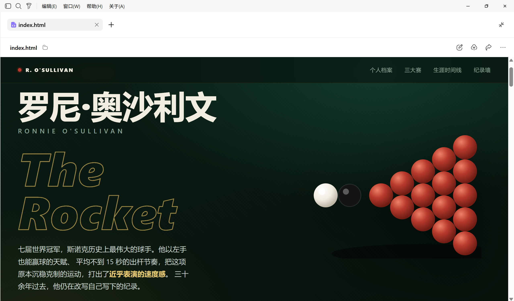
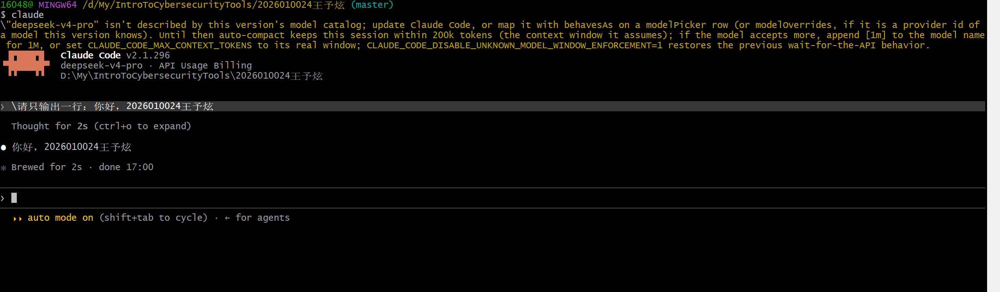

# Lab2：AI Agent 工具的安装与使用

> **作业目标**：安装并使用 WorkBuddy，制作一个主题自选的单文件网页并部署到公网，提交网页文件 `index.html` 和公网展示截图；在 DeepSeek 开放平台充值 1 元，通过 CC Switch 为 Claude Code 配置 DeepSeek API，并让 Claude Code 输出“你好，学号姓名”。
>
> **提交前请先阅读**：本次作业只允许提交本文末尾列出的 4 个文件：`Lab2.md`、`index.html` 和两张截图。网页只准提交 `index.html` 这一个文件，CSS 和 JavaScript 必须集成在其中。必须完整保留本报告模板的标题、说明、示例、表格和图片引用，只能在指定位置填写自己的信息与结果。本次启用报告总行数、非空行数和 Markdown 字符数量检测，具体要求见第五节。

---

## 一、了解本次使用的工具并填写信息

### 1.1 四个工具分别做什么

| 工具或服务 | 在本实验中的作用 |
| --- | --- |
| WorkBuddy | 通过图形界面提出要求，让 AI Agent 制作单文件网页并部署到公网 |
| Claude Code | 在终端中使用的 AI Agent 工具，本次先完成安装和一次简单对话 |
| DeepSeek API | 为 Claude Code 提供模型服务，按实际调用的 Token 用量计费 |
| CC Switch | 管理 Claude Code 的 API 地址、密钥和模型配置，方便切换服务提供商 |

WorkBuddy 适合从自然语言和图形界面入门；信息安全专业的同学还应熟悉终端中的工具，因此本次也使用 Claude Code。

**本次的 1 元用于充值 DeepSeek API 余额，不是购买 Claude 官方订阅，也不是购买 DeepSeek 网页聊天会员。** 本实验面向中国大陆的使用环境，采用 DeepSeek 官方提供的 Claude Code 接入方式。配置后，终端工具仍叫 Claude Code，实际回答由 DeepSeek 模型生成。

### 1.2 填写基本信息

将下表第二列中的填写提示替换为自己的信息，不得删除表格行。

| 项目 | 内容 |
| --- | --- |
| 姓名 | （填写） |
| 学号 | （填写 10 位学号） |

---

## 二、使用 WorkBuddy 制作网页并部署到公网

### 2.1 安装和登录

1. 打开 [WorkBuddy 官网](https://www.codebuddy.cn/work/)，下载适合自己电脑的桌面客户端，完成安装并登录。
2. 本次使用账号提供的免费额度即可，不要求购买 WorkBuddy 付费套餐。免费额度及刷新规则以账号实际页面为准。
3. 在电脑上新建一个用于本次练习的文件夹，在 WorkBuddy 中选择该文件夹作为工作目录。该目录建议放在课程仓库之外，完成后只把最终的 `index.html` 复制到作业目录，避免混入临时文件和部署配置。

### 2.2 制作一个单文件网页

网页主题自选，例如“大学生网络安全常识”“我的大学学习计划”“家乡介绍”或“个人作品展示”。不要求统一版式或复杂交互，但页面应有与主题相关的实际内容，不能只有空白页面或标题。

网页文件必须满足：

1. **文件名必须是 `index.html`，全部小写。** 不要在文件名中添加学号、姓名或主题。
2. 只使用这一个 HTML 文件。CSS 写在文件内的 `<style>` 标签中；如果使用 JavaScript，写在文件内的 `<script>` 标签中，不强制设计交互功能。
3. 不得另交或引用外部 `.css`、`.js` 文件，也不得通过 CDN 加载样式、脚本或框架。需要图案时可使用 CSS 绘制、内嵌 SVG 或 Data URL，避免依赖额外图片、字体等资源文件。
4. 网页应能直接用浏览器打开，不依赖构建命令、后端程序或其他本地文件。使用 UTF-8 编码，`index.html` 大小不超过 200000 字节，避免内嵌大图片导致文件过大。

可以参考下面的提示词。请在发送给 WorkBuddy 时按自己的需要调整主题，报告中保留这段示例原文：

```text
请制作一个主题为“大学生网络安全常识”的网页，内容包括密码安全、识别钓鱼消息和个人信息保护。
最终只生成 index.html 一个网页文件：CSS 放在文件内的 style 标签中，如有 JavaScript 则放在 script 标签中，不引用外部样式、脚本、框架或其他资源文件。
页面应能直接用浏览器打开，使用 UTF-8 编码，文件大小不超过 200000 字节。
请把 index.html 保存到当前工作目录。
```

生成后，用浏览器打开本地 `index.html`，检查内容和排版。如果页面空白、样式丢失或交互有问题，继续让 WorkBuddy 修改，直到能够正常显示。只在聊天中输出设计方案或声称“已完成”，不算完成。

### 2.3 让 WorkBuddy 部署到公网

本地预览成功后，继续向 WorkBuddy 提出部署要求，例如：

```text
请把当前 index.html 部署到可公开访问的静态网站，保留单文件结构，并给我完整的公网访问网址。
请使用可用的免费托管方式；如需登录部署平台或授权，请说明操作步骤。
部署后请检查网页能否正常访问，确保线上内容与本地 index.html 一致。
```

1. 可以使用 WorkBuddy 当前提供的网页发布方式，或让它协助部署到 GitHub Pages 等静态网站托管服务。按提示完成平台登录和必要授权，使用平台提供的网址即可，不要求购买域名或服务器。
2. 部署完成后，在浏览器中打开返回的完整 `https://` 或 `http://` 网址，确认看到自己的网页内容。网址必须能通过公网访问，不能是 `file://`、`localhost`、`127.0.0.1` 或局域网地址。
3. 使用浏览器无痕窗口，在未登录托管平台的情况下访问该网址，确认其他人无需登录也能查看。公网网页应在作业审核期间保持可访问，不能提交后立即删除部署。
4. 如果 WorkBuddy 只启动了本地预览，或给出的链接显示未发布、要求登录、404 等提示，应继续完成公网部署。修改页面后要重新部署，并确保提交的 `index.html` 是与线上页面对应的最终版本。

部署配置或平台项目可以保留在练习目录或单独的部署仓库中，本课程作业只提交网页本体 `index.html`。不要把 API Key、密码或部署令牌写入网页源码。

| 项目 | 内容 |
| --- | --- |
| 网页主题 | （填写自选主题） |
| 公网访问地址 | （填写完整网址，包含 https:// 或 http://） |

### 2.4 公网网页展示截图

在浏览器中打开已经部署的公网网址，截图必须在同一张图中清晰显示：

- 浏览器地址栏中的公网域名及页面路径，与报告填写的网址对应；
- 正常加载的网页主题和主要内容。

适当调整浏览器窗口或缩放比例，让地址栏和主要内容同时可见。截图对象是公网网页，不是 WorkBuddy 聊天、部署控制台或本地预览；不要求另外提交 WorkBuddy 操作过程截图。

截图必须保存为 `imgs/workbuddy_web.png`。将截图放入指定目录后，下面应能正常显示图片：



---

## 三、充值 DeepSeek API 并通过 CC Switch 接入 Claude Code

### 3.1 在 DeepSeek 开放平台充值 1 元

1. 打开 [DeepSeek 开放平台](https://platform.deepseek.com/)，注册或登录自己的账号。
2. 在平台的充值页面选择或输入 **1 元人民币**，按页面提示完成支付，确认 API 可用余额到账。本次小额充值用于体验按量付费，不要求购买包月套餐或大额充值。
3. 在 **API keys** 页面创建一个用于本次实验的 API Key，妥善保存在本人电脑上，后面粘贴到 CC Switch 中。
4. 充值余额用于 API 调用，具体价格可查看 [DeepSeek 模型与价格](https://api-docs.deepseek.com/zh-cn/quick_start/pricing)。一次简短问候不需要长对话或复杂任务，完成后可回到平台查看用量。

**API Key 相当于调用服务的密码。不要把它填进报告、聊天提示词、截图或 GitHub 仓库，也不要将自己的密钥发给其他人。** 本次不要求提交支付记录、余额页面或密钥页面截图。

### 3.2 安装 Claude Code

Claude Code 和 CC Switch 应安装在**同一台电脑、同一个操作系统和同一个用户账号**下。本次 Windows 同学直接在 Windows 中安装使用即可。

**Windows：在 Git Bash 中安装**

本次统一使用 Git Bash 运行安装命令和启动 Claude Code。Git for Windows 自带 Git Bash，为 Claude Code 提供执行命令所需的 Bash 环境；Node.js 自带 npm，用于下载和安装 Claude Code。

1. 安装 [Git for Windows](https://git-scm.com/downloads/win)，默认安装选项即可。此前提交课程作业时已经安装过的同学可以跳过这一步。
2. 打开 [Node.js 下载页](https://nodejs.org/zh-cn/download)，选择 **LTS 版本的 Windows 安装程序（`.msi`）**，完成安装。使用 Node.js 22 或更高版本的 LTS，保留 npm 和添加到 PATH 的默认选项。
3. 安装完成后，从开始菜单打开 **Git Bash**。如果安装前已有终端窗口，请关闭后重新打开。在 Git Bash 中依次执行：

```bash
git --version
node --version
npm --version
```

三条命令都应输出版本号。如果出现 `command not found`，先检查对应软件是否安装完成，并重新打开 Git Bash。

4. 在同一个 Git Bash 窗口中安装 Claude Code。本次使用国内 npm 镜像下载：

```bash
npm install -g @anthropic-ai/claude-code --registry=https://registry.npmmirror.com
```

`--registry` 只为本次安装指定镜像地址，不会修改 npm 的全局源设置。如果镜像临时不可用或尚未同步版本，可将地址换成 `https://registry.npmjs.org` 重试。

5. 安装完成后，关闭并重新打开 Git Bash，执行：

```bash
claude --version
```

能显示版本号说明命令已安装成功。此时先完成下面的 API 配置，再开始对话。npm 接入方式可参考 [DeepSeek 接入 Claude Code 文档](https://api-docs.deepseek.com/zh-cn/quick_start/agent_integrations/claude_code)；Claude Code 官方目前优先推荐原生安装，本实验统一采用 npm 方式，便于使用国内镜像。

**macOS：**如果已安装 Homebrew，在终端中执行：

```bash
brew install --cask claude-code
claude --version
```

其他安装方式可查看 [Claude Code 官方安装说明](https://github.com/anthropics/claude-code#get-started)。版本号能正常显示后，继续完成 API 配置。

### 3.3 安装 CC Switch 并配置 DeepSeek

1. 打开 [CC Switch 项目主页](https://github.com/farion1231/cc-switch)，从 [Releases 下载页](https://github.com/farion1231/cc-switch/releases/latest)下载对应系统的安装包。Windows 选择 Windows 安装包，macOS 选择 macOS 安装包。
2. 安装并打开 CC Switch，选择 **Claude Code**，进入添加供应商页面。
3. 选择 **DeepSeek 官方 API** 对应的预设，填入自己的 API Key；没有该预设时，选择自定义配置并按下表填写。
4. 检查 API 地址和模型配置，保存后点击该供应商的 **启用** 或切换按钮。本次使用 DeepSeek 的 Anthropic 兼容接口，采用直连配置即可。

| 配置项 | 本次使用的值 |
| --- | --- |
| 管理的工具 | Claude Code |
| 供应商名称 | DeepSeek，可自行添加备注 |
| API 地址／Base URL | `https://api.deepseek.com/anthropic` |
| API Key／Auth Token | 本人在 DeepSeek 开放平台创建的密钥，只填入本机 CC Switch |
| 模型 | 当前可使用 `deepseek-flash`；新版预设中的 `deepseek-flash[1m]` 也可使用 |

如果界面分别提供默认模型和 Sonnet、Opus、Haiku 模型映射，可将这些位置都指向同一个 DeepSeek Flash 模型。模型名称会随服务更新，以 [DeepSeek 官方接入说明](https://api-docs.deepseek.com/zh-cn/quick_start/agent_integrations/claude_code)为准，不要把显示的 Claude 档位名称误认为实际使用了 Claude 官方模型。

该地址采用 Anthropic 兼容格式，不能直接换成面向其他协议的地址，也不要在末尾自行追加 `/v1/messages`。CC Switch 的作用是管理连接配置，API 调用费用仍由 DeepSeek 收取。

### 3.4 启动并检查连接

1. 关闭之前打开的 Claude Code 会话。Windows 同学在自己的练习文件夹内右键选择 **Open Git Bash here**；Windows 11 若未直接显示，可先点击“显示更多选项”。macOS 同学打开终端，用 `cd` 切换到自己的练习文件夹。
2. 执行下面的命令启动 Claude Code：

```bash
claude
```

3. 首次启动时，按提示完成界面设置。需要确认工作目录时，核对是自己的练习目录后再继续。
4. 若仍要求登录 Claude 官方账号，先检查 CC Switch 是否已在 **Claude Code** 页面启用 DeepSeek。第三方 API 配置已正确启用但仍卡在首次引导时，可在 CC Switch 设置中使用“跳过 Claude Code 初次安装确认”，然后重新启动。这与关闭文件操作、命令执行的权限确认不是一回事。
5. 若出现鉴权或余额错误，分别检查密钥是否复制完整、API 余额是否到账；若出现地址或模型错误，重新核对上表和官方接入说明。若旧配置覆盖了新配置，可使用 CC Switch 的环境变量冲突检查功能排查。

---

## 四、让 Claude Code 输出问候语并截图

在 Claude Code 的输入区发送下面的提示词。发送前将其中的“我的10位学号我的姓名”替换为本人真实信息，报告中保留示例原文：

```text
请只输出一行：你好，我的10位学号我的姓名
```

例如，学号为 `2026010099`、姓名为“张三”的同学，应收到：

```text
你好，2026010099张三
```

必须由 Claude Code 调用模型并返回问候语，不能用 `echo`、`print` 或手工输入冒充模型回复。仅在提示词里出现学号姓名、没有模型实际回复，不算完成。

截图必须在同一张图中清晰显示：

1. 能辨认出 Claude Code 的终端界面。
2. 本人发送的问候语请求。
3. Claude Code 已返回的“你好，本人10位学号姓名”。标点或空格的合理差异可以接受，但学号和姓名必须正确。

截图必须保存为 `imgs/claude_code_hello.png`。无需另外提交安装、版本、CC Switch 配置或 API 充值截图。



---

## 五、提交要求

将本文件复制到自己的 `学号姓名/Lab2/Lab2.md`，填写基本信息、网页主题与公网访问地址，并保留两张截图的 Markdown 图片引用。将最终的 `index.html` 放在自己的 `Lab2` 文件夹内，两张图片放在其中的 `imgs` 文件夹中。最终只提交以下 4 个文件：

```text
学号姓名/
└── Lab2/
    ├── Lab2.md
    ├── index.html
    └── imgs/
        ├── workbuddy_web.png
        └── claude_code_hello.png
```

特别注意：

- 所有指定填写项、`index.html` 和两张截图全部必交，不得留空或缺交；网页内容应与公网展示结果一致。本次不要求额外撰写心得或回答简答题。
- 必须完整保留模板，只替换表格中的填写提示；不得删除或改写标题、说明、示例、表格行、图片引用和小节。
- **自动审核会检查 `Lab2.md` 的总行数、非空行数，以及 `#`、`-`、`*`、反引号、`|`、`>` 六类字符的数量，每一项都不能少于发布模板。** 不得删减空行、说明或排版符号。这项模板数量检查只针对报告，不对 `index.html` 设置相同的行数或字符数量门槛；网页按内容和单文件要求审核。
- 两张截图均须使用本人实际操作结果和电脑截图功能，严禁使用手机拍摄屏幕；网页截图的公网地址与页面内容、Claude Code 截图中的问候语必须清晰可读。允许合理裁剪无关区域，但不得裁掉网页截图的地址栏，也不能裁掉其他验收所需的信息。
- 截图不得显示 API Key、密码或支付敏感信息；如意外暴露密钥，应先在平台撤销并重新创建，再使用不含密钥的截图。
- 两张图片均使用 PNG 格式，单个文件均不得超过 5 MB；文件名必须与目录结构完全一致，单词之间使用下划线 `_`。
- 网页只准交 `index.html` 这一个文件，CSS 和 JavaScript 均须写在该文件内；不要提交其他 HTML、独立 CSS 或 JS、资源文件夹、压缩包、部署配置、安装包、密钥或额外报告、截图。报告与两张验收截图不计入网页资源文件。
- `Lab2`、`Lab2.md`、`index.html`、`imgs` 和截图文件名均区分大小写。不得用外部图片链接或 PR 描述中的图片代替本地截图；提交前预览 `Lab2.md`，确认两张图片均能正常显示，并重新打开公网网址及本地 `index.html` 检查。
- PR 标题必须严格使用 `[学号姓名]Lab2作业提交`，右方括号后不能有空格。
- 一个 PR 只能包含本次 Lab2 的 4 个文件，不得修改其他同学、`homework/`、README 或仓库配置。

---

## 六、截止时间

**2026 年 10 月 19 日 24:00（即 2026 年 10 月 20 日 00:00，北京时间）**

以 GitHub 记录的最后一次向 PR 推送代码的时间为准。不晚于上述时刻创建 PR 并完成最后一次推送不算超时；超过该时刻新建 PR，或向已有 PR 推送任何修改，均算作超时。审核未通过的同学请务必在截止前完成修改。
